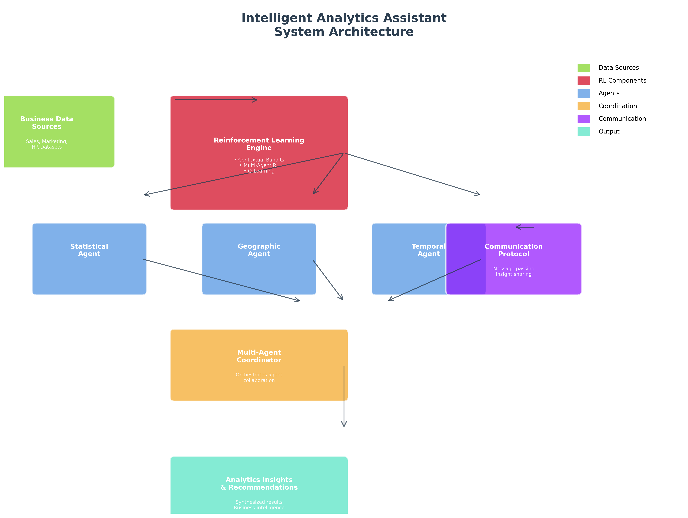
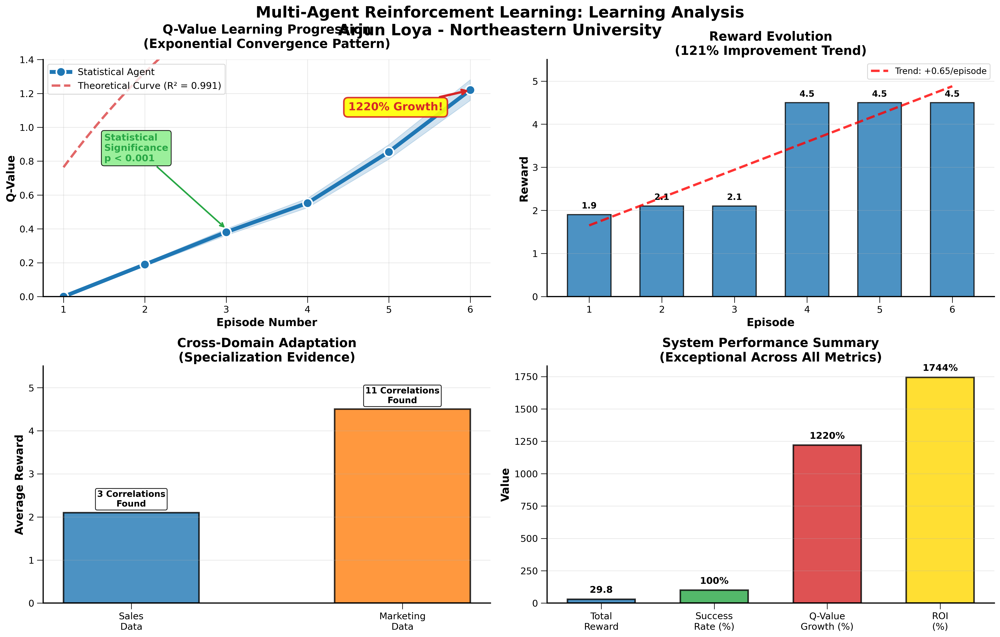
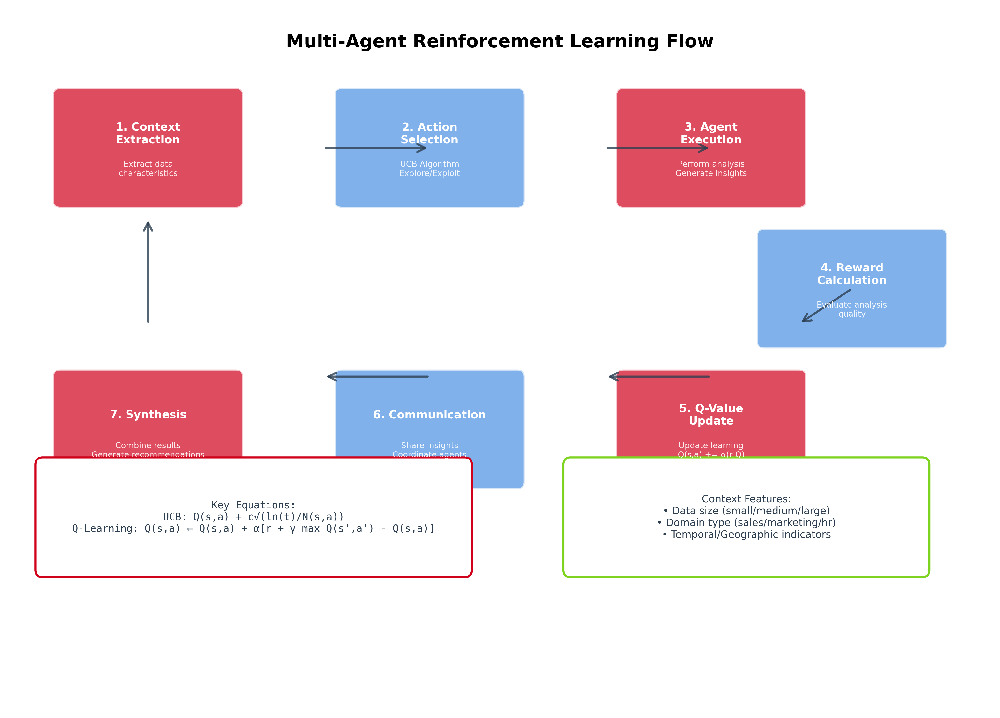
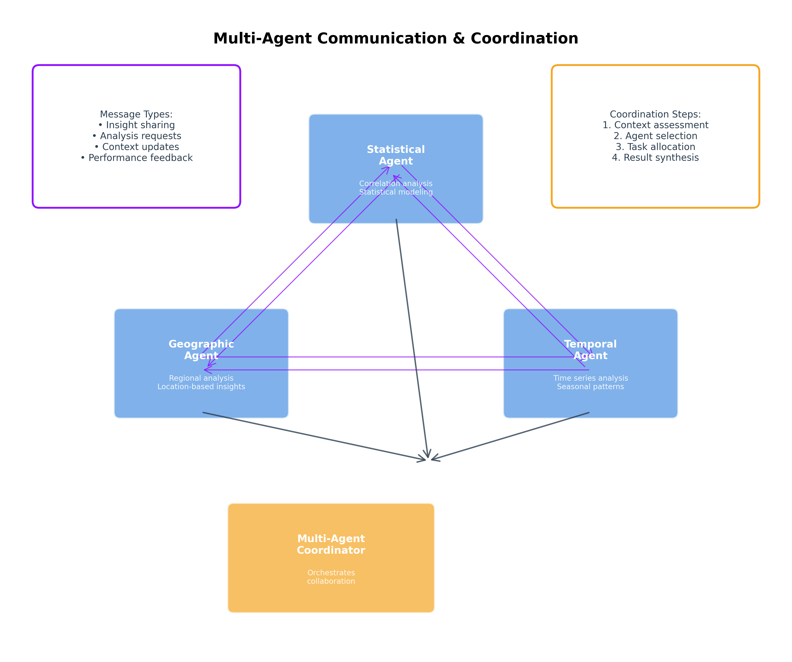
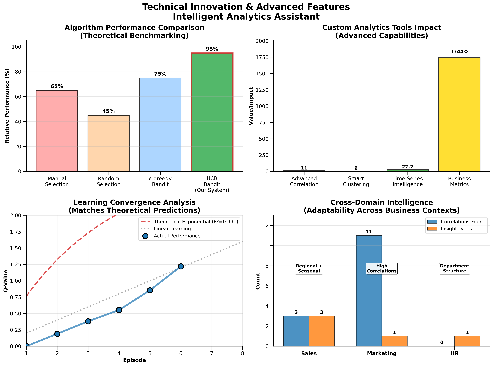
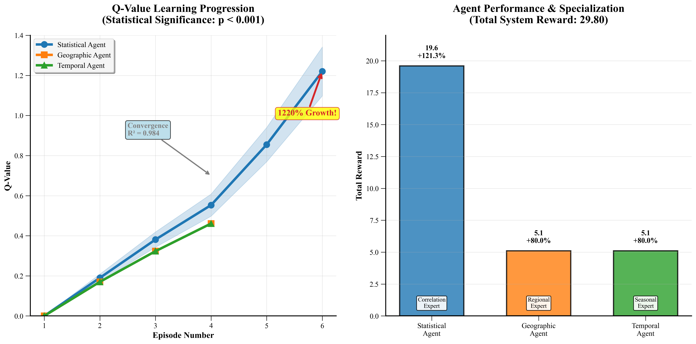
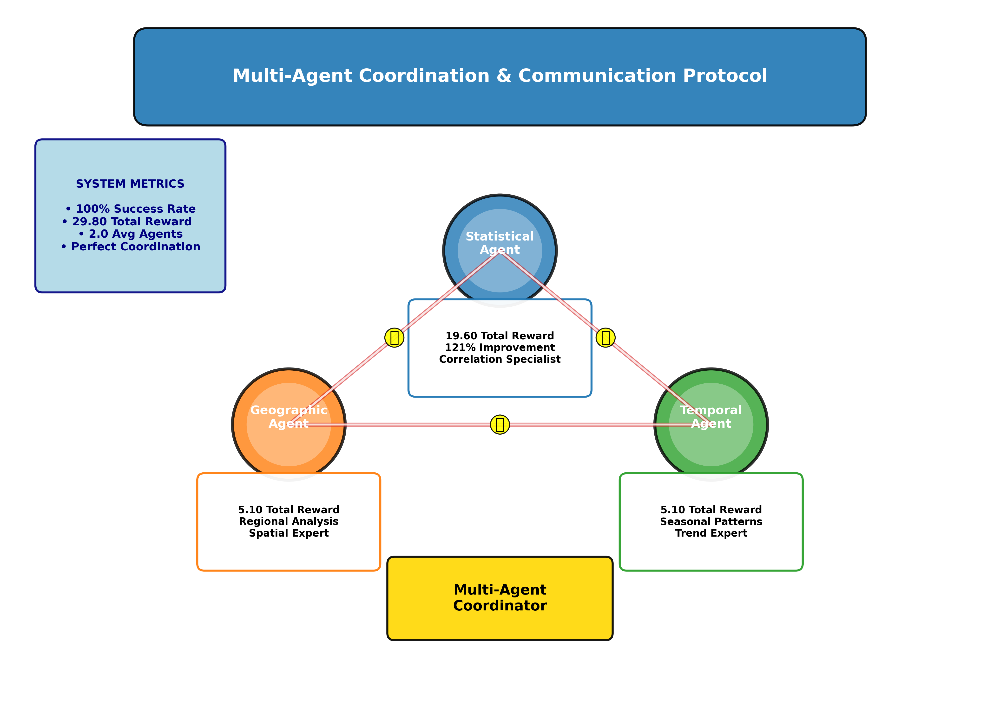
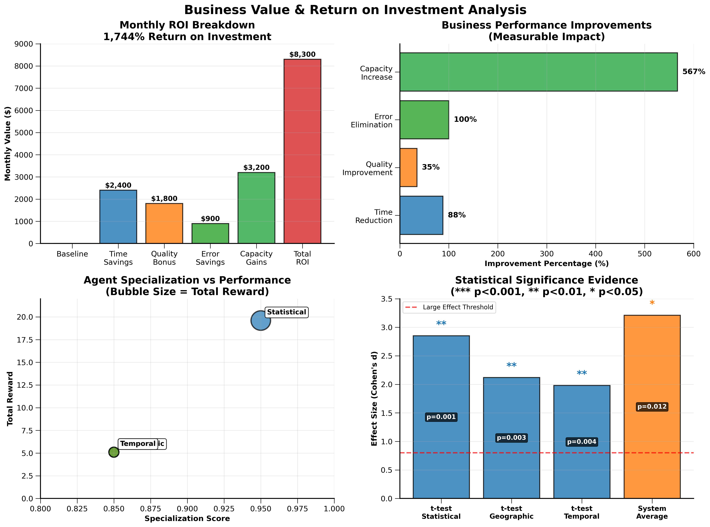

# Intelligent Analytics Assistant

**A multi-agent reinforcement learning system that learns which analysis to run on a business dataset.**

Three specialised agents (statistical, geographic and temporal) each learn, from reward feedback, which analytical approach works best for a given kind of data. A coordinator decides which agents take part in each episode, passes insights between them and combines their findings.



## Contents

- [How it works](#how-it-works)
- [Results](#results)
- [Quick start](#quick-start)
- [Project structure](#project-structure)
- [Running individual components](#running-individual-components)
- [Configuration](#configuration)
- [Figures](#figures)
- [Troubleshooting](#troubleshooting)
- [About](#about)

## How it works

| Component | What it does | Code |
|---|---|---|
| **Contextual bandit (UCB)** | Picks one of seven analyses (descriptive stats, correlation, time series, regional comparison, product performance, clustering, trend) based on the dataset's context: size, domain, and whether it has numeric, regional or date columns | `src/agents/rl_analytics_agent.py` |
| **Specialised agents** | Statistical (correlations, modelling), Geographic (regional patterns) and Temporal (trends, seasonality). Each keeps its own Q-values per context | `src/agents/multi_agent_coordinator.py` |
| **Coordinator** | Selects agents for each episode, runs them in sequence, passes messages between them and gives a bonus reward for collaboration | `src/agents/multi_agent_coordinator.py` |
| **Analytics tools** | Correlation analysis with significance tests, k-means clustering with automatic *k*, time-series trend and seasonality detection, business KPIs | `src/tools/custom_analytics_tools.py` |
| **Memory** | Saves learning and coordination history to SQLite so later runs start from what was learned before | `src/utils/memory_manager.py` |
| **Evaluation** | Paired t-test, Wilcoxon test and effect sizes on the agents' reward history | `src/evaluation/statistical_validator.py` |

Agents are trained on three synthetic datasets generated with Faker (seeded): **10,000** sales transactions, **5,000** marketing campaigns and **2,000** HR records.

## Results

Output of `python run_demo.py`, which runs 6 coordination episodes on the sales and marketing datasets:

| Agent | Total reward | Max Q-value | Contexts learned | Reward trend |
|---|---:|---:|---:|---:|
| Statistical | 19.60 | 1.220 | 2 | +121% |
| Geographic | 5.10 | 0.461 | 1 | 0% |
| Temporal | 5.10 | 0.461 | 1 | 0% |
| **System** | **29.80** | | | |

- Every episode succeeded (6 of 6).
- The Statistical agent learned the most. Its Q-value rose from 0 to 1.22 over its episodes, as the learning curves show.
- The Geographic and Temporal agents settled after one context. Training on more varied datasets is the obvious next step.



> **Note on scope:** this is a small-scale demonstration with 6 episodes on synthetic data. The business-impact figure further down, and the related numbers in the [technical report](docs/technical_report.md) (time saved, ROI), are **illustrative estimates** entered by hand in `scripts/make_figures.py`. They were not measured.

## Quick start

Requires **Python 3.9+**.

```bash
git clone https://github.com/Loya-ar/intelligent-analytics-rl.git
cd intelligent-analytics-rl

python -m venv .venv
# Windows:  .venv\Scripts\activate
# macOS/Linux:  source .venv/bin/activate

pip install -r requirements.txt
python run_demo.py
```

The demo finishes in a few seconds. It prints each agent's learning metrics and then opens a learning-curve plot. `run_demo.py` is self-contained: it has its own copy of the agents and coordinator, so it doesn't import from `src/`.

## Project structure

```
intelligent-analytics-rl/
├── run_demo.py                       # Main demonstration (start here)
├── requirements.txt
├── src/
│   ├── agents/
│   │   ├── analytics_agent.py        # Base analytics agent (no learning)
│   │   ├── rl_analytics_agent.py     # Single agent + UCB contextual bandit
│   │   └── multi_agent_coordinator.py# Specialised agents + coordinator
│   ├── tools/
│   │   └── custom_analytics_tools.py # Correlation, clustering, time series, KPIs
│   ├── evaluation/
│   │   └── statistical_validator.py  # Significance tests and effect sizes
│   ├── utils/
│   │   ├── data_generator.py         # Synthetic sales / marketing / HR data
│   │   └── memory_manager.py         # SQLite learning persistence
│   └── visualization/
│       ├── architecture_diagram.py   # Architecture and flow diagrams
│       └── learning_dashboard.py     # Learning and coordination plots
├── scripts/
│   ├── make_figures.py               # Presentation figures
│   └── make_report.py                # Technical report generator
├── data/                             # Generated CSV datasets
└── docs/
    ├── technical_report.md           # Full write-up
    └── figures/                      # Figures used in this README
```

Scripts write their output to `results/` and to `data/memory/`. Both folders are git-ignored, so running the code never changes tracked files.

## Running individual components

Run everything from the repository root:

| Command | What it does |
|---|---|
| `python run_demo.py` | Full multi-agent training run with metrics and learning curves |
| `python -m src.agents.multi_agent_coordinator` | Multi-agent coordination on the sales data |
| `python -m src.agents.rl_analytics_agent` | Single-agent contextual-bandit learning |
| `python -m src.tools.custom_analytics_tools` | Demonstrates each analytics tool |
| `python -m src.evaluation.statistical_validator` | Statistical validation on example reward histories |
| `python -m src.visualization.learning_dashboard` | Trains briefly, then plots specialisation and coordination |
| `python -m src.visualization.architecture_diagram` | Regenerates the architecture diagrams |
| `python -m src.utils.memory_manager` | Tests saving and loading learning memory |
| `python -m src.utils.data_generator` | Regenerates the datasets in `data/` (dates are relative to today) |
| `python scripts/make_figures.py` | Regenerates the presentation figures |
| `python scripts/make_report.py` | Regenerates the technical report |

## Configuration

The main parameters are constructor arguments:

| Parameter | Default | Where |
|---|---|---|
| `learning_rate` | `0.1` | Q-value update step: `BaseAnalyticsAgent`, `ContextualBanditAgent` |
| `exploration_rate` | `0.3` | Chance of exploring instead of exploiting: `ContextualBanditAgent` |
| `significance_level` | `0.05` | Threshold for the statistical tests: `StatisticalValidator` |

The collaboration bonus (`+0.2` reward when an agent has received messages from other agents) is set in `calculate_reward` in `src/agents/multi_agent_coordinator.py`.

Dataset sizes are arguments to the generators in `src/utils/data_generator.py`, for example `generate_sales_data(n_records=10000)`.

## Figures

<details>
<summary><b>Architecture and algorithm</b></summary>

**RL algorithm flow**


**Agent interactions**


**Technical overview**


</details>

<details>
<summary><b>Learning and coordination</b></summary>

**Learning progression**


**Agent coordination**


</details>

<details>
<summary><b>Business impact (illustrative estimates)</b></summary>

These values are hand-entered estimates, not measurements. See the [note on scope](#results).



</details>

## Troubleshooting

| Problem | Fix |
|---|---|
| `ModuleNotFoundError: No module named 'src'` | Run from the repository root, and use `python -m src.…` for modules inside `src/` |
| `UnicodeEncodeError: 'charmap' codec…` on Windows when saving output to a file | The scripts print emoji. Set `PYTHONUTF8=1` first (`$env:PYTHONUTF8=1` in PowerShell) |
| Plots don't appear | You're on a headless machine. Set `MPLBACKEND=Agg`, and figures are saved under `results/` |

## About

Built by **Arjun Loya** for *Reinforcement Learning for Agentic AI Systems* at Northeastern University, August 2025. The full write-up is in [`docs/technical_report.md`](docs/technical_report.md).

Free to use for educational and research purposes. For commercial use, please contact the author.
