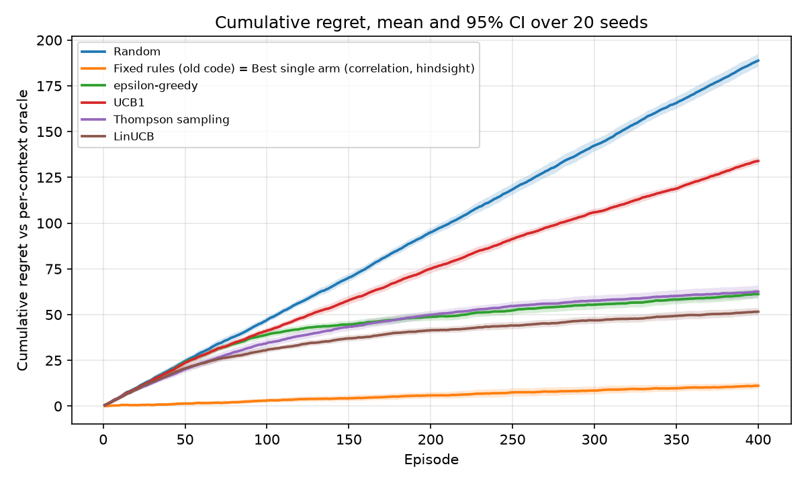

# Intelligent Analytics: Bandits vs. Baselines for Choosing an Analysis

[](https://github.com/Loya-ar/intelligent-analytics-rl/actions/workflows/ci.yml)

**Given a slice of a business dataset, which of 7 analyses should an agent run?** This repo benchmarks multi-armed and contextual bandits against fixed rules, random choice, a zero-shot LLM and an oracle, on 4 real public datasets. The reward is whether the analysis's findings **replicate on held-out data**.

## Results at a glance

- **8 methods compared:** random, the old fixed column rules, ε-greedy, UCB1, Thompson sampling, LinUCB, an LLM chooser (Gemini, zero-shot) and a per-context oracle.
- **The benchmark:** 400 episodes × 20 seeds, drawn from 1,200 real-data episodes (300 per dataset) across 4 public datasets.
- **The fixed rule was already near-optimal.** Always running correlation, which is what the old rules do, earns **96.1%** of the oracle's reward. The best possible context-based choice is only about 4% better than that, so there was little for learning to gain.
- **The bandits learn but don't win in 400 episodes.** LinUCB reaches **82.0%** of the oracle over the whole run and **93.4%** in its last 100 episodes; Thompson sampling 78.2% / 93.0%, ε-greedy 78.7% / 92.0%. UCB1 over-explores across 12 contexts: 53.3% / 60.4%. Random gets 34.2%.
- **Transfer (leave one dataset out):** pre-training LinUCB on the other 3 datasets beats a cold start significantly on 3 of the 4 held-out datasets (for example 70.2% vs. 65.1% of the oracle on retail; paired tests, Holm-corrected). It still trails the fixed rule, except on telco, where they're level (90.9% vs. 90.8%).
- **Every comparison is significance-tested:** paired t-tests and Wilcoxon signed-rank tests, paired by seed, with Holm correction. The fixed rule beats every bandit significantly, even over their last 100 episodes.
- **The zero-shot LLM did poorly.** On 100 fixed episodes, Gemini (`gemini-3.5-flash-lite`) earned **45.8%** of the oracle's reward, against 33.1% for random. It picked descriptive stats 75 times. LinUCB, after 400 learning episodes, got **97.2%** on the same episodes, and the fixed rule 94.7%. The LLM took a median of **0.70 s** per call, used about 436 tokens per call and cost **$0** on the free tier.

## Contents

- [How it works](#how-it-works)
- [Results](#results)
- [Data](#data)
- [Reproduce](#reproduce)
- [Project structure](#project-structure)
- [Limitations](#limitations)
- [About](#about)

## How it works

**Episode.** Pick one of the 4 datasets at random. Take a random slice of it: a time window of 3, 7, 14 or 30 days (datasets with dates, half the time), or a segment such as `Contract = Month-to-month`. Subsample the slice to 400, 1,500 or 5,000 rows, then split it at random into a *discovery* half and a *held-out* half. The method sees only the slice's context (features listed below) and picks **one** analysis.

**Arms: the 7 analyses.** Each one makes claims on the discovery half. Every claim is a hypothesis test with p < 0.05, and it is re-tested on the held-out half.

| Analysis | Claim on the discovery half | Replicates on the held-out half if… |
|---|---|---|
| Descriptive stats | The slice's mean of an outcome differs from the whole dataset's mean (one-sample t-test) | p < 0.05, same direction |
| Correlation | Spearman ρ between two numeric columns, \|ρ\| ≥ 0.1. Pairs already \|ρ\| ≥ 0.5 across the whole dataset (such as fare vs. total) are known facts and don't count | p < 0.05, same sign |
| Time series | The outcome varies by hour of day (slices ≤ 14 days) or by day of week (Kruskal–Wallis) | p < 0.05 and the profile of bin means correlates positively |
| Regional comparison | Best vs. worst region on an outcome (Mann–Whitney) | Same two regions: p < 0.05, same direction |
| Product performance | Each of the top 10 products vs. the rest (Mann–Whitney) | p < 0.05, same direction |
| Clustering | k-means with k = 2–5 has silhouette ≥ 0.25, which counts as k claims | k-means on the held-out half agrees with the discovery centroids (adjusted Rand index ≥ 0.6) |
| Trend | A significant linear trend on the earlier 70% of the slice by time | Extrapolating the trend to the later 30% beats a naive forecast (mean of the last 7 periods) on MAE |

**Reward**, from `src/selector/analyses.py`:

```
reward = (replicated − 0.5 × failed) / 5 − cost[analysis]
```

- Only the 5 most significant claims count, so the reward is at most 1. This stops analyses that test many things from winning on volume alone.
- A false claim costs half as much as a true one earns.
- `cost` is a fixed compute charge, from 0.005 (descriptive stats) to 0.03 (clustering). It roughly follows the measured median runtimes (3 ms to 160 ms) and is fixed rather than timed, so rewards reproduce exactly.
- An analysis that can't run on a slice (trend with no date column, say) scores −cost.

**Context features** for LinUCB are generic, so they transfer across datasets: log row count, number of numeric columns, whether the slice has a date / region / product column, log time span, time-window vs. segment slice, share of zeros in the main outcome, and number of category levels. The tabular bandits (ε-greedy, UCB1, Thompson sampling) keep separate statistics for each of 12 discrete contexts (dataset × slice size).

**Methods**, from `src/selector/methods.py`:

| Method | How it chooses |
|---|---|
| Random | Uniform over the 7 analyses |
| Fixed rules (old code) | The original coordinator's order: correlation if there are ≥ 2 numeric columns, else regional, else time series. Every dataset here has ≥ 2 numeric columns, so this is always correlation |
| ε-greedy | ε = 0.1, sample means per context |
| UCB1 | Mean + √(2 ln n / nₐ) per context |
| Thompson sampling | Gaussian: prior N(0, 1) and noise sd 0.25, per context |
| LinUCB | Disjoint LinUCB (Li et al., 2010), α = 1, on the context features |
| LLM chooser | Gemini sees a text summary of the dataset and slice plus the scoring rule, and picks one analysis. It gets no feedback |
| Oracle | The analysis with the best mean reward for each context (dataset × slice size) across all 1,200 episodes. It is the reference for regret |

No hyperparameters were tuned on these results. Every bandit uses the textbook default.

**Why a table of rewards.** All 7 analyses are run once on every episode and the results are saved to `reports/reward_table.csv`. Every method is then replayed on exactly the same episodes (each seed draws its own sequence of 400), which takes about 5 seconds. CI rebuilds a sample of these rows from the raw data to show the table comes from the code.

## Results

All numbers come from [`reports/results.md`](reports/results.md), written by `python run_all.py`. Values are mean ± 95% CI over 20 seeds.

| Method | % of oracle reward | % of oracle, last 100 episodes | Cumulative regret after 400 episodes |
|---|---:|---:|---:|
| Random | 34.2 ± 1.1 | 34.5 ± 2.4 | 188.8 ± 3.5 |
| Fixed rules (old code) = always correlation | **96.1 ± 0.6** | **96.3 ± 1.5** | **11.1 ± 1.8** |
| ε-greedy | 78.7 ± 0.8 | 92.0 ± 1.8 | 61.2 ± 2.5 |
| UCB1 | 53.3 ± 0.6 | 60.4 ± 2.5 | 134.0 ± 2.0 |
| Thompson sampling | 78.2 ± 1.0 | 93.0 ± 1.8 | 62.6 ± 3.3 |
| LinUCB | 82.0 ± 0.7 | 93.4 ± 1.6 | 51.6 ± 2.1 |
| Oracle (best analysis per context) | 100 | 100 | 0 |



**How much room there was.** Correlation is the best analysis in 62% of episodes, product performance in 18% and clustering in 12%. The oracle switches away from correlation in 5 of the 12 contexts: product performance for all telco slices and for medium taxi slices, and clustering for small Hillstrom slices. Even so, it beats always-correlation by only about 4%. The per-episode best analysis in hindsight is about 13% better again, but that gap can't be predicted from the context features.

**What happened.** The learning methods find the good analyses: their regret curves bend after about 100–150 episodes, and by the last 100 episodes LinUCB, Thompson sampling and ε-greedy are 3–4 points below the fixed rule. Over 400 episodes, though, exploring 7 analyses costs more than the 4% that was available. UCB1 does worst of the bandits because its exploration bonus is large for this reward scale and it keeps it separately for each of the 12 contexts.

**Are the gaps real?** Each method was compared with the fixed rule, paired by seed (n = 20; every method sees the same episodes for a given seed). The p-values below are Holm-corrected across all 8 comparisons. The reward difference is the method's total reward minus the fixed rule's over that window.

| Method | Over all 400 episodes | Over the last 100 episodes |
|---|---|---|
| ε-greedy | −50.1, t-test p = 3e-21, Wilcoxon p = 2e-5 | −3.1, p = 2e-5 / 2e-5 |
| UCB1 | −122.8, p = 1e-27 / 2e-5 | −25.4, p = 3e-16 / 2e-5 |
| Thompson sampling | −51.4, p = 4e-19 / 2e-5 | −2.3, p = 0.006 / 0.003 |
| LinUCB | −40.5, p = 5e-18 / 2e-5 | −2.1, p = 0.003 / 0.002 |

So the fixed rule is significantly better than every bandit, even over the bandits' last 100 episodes, though there the gap is only about 2–3 reward units out of roughly 69. (2e-5 is the smallest p-value an exact Wilcoxon test can give with 20 pairs.)

### Transfer: leave one dataset out

LinUCB learns for 300 episodes on the other 3 datasets, then runs 100 episodes on the held-out one (still learning). The table shows % of the held-out dataset's oracle.

| Method | hillstrom | retail | taxi | telco |
|---|---:|---:|---:|---:|
| LinUCB, pre-trained on the other 3 | 79.7 ± 2.7 | 70.2 ± 1.3 | 84.1 ± 2.5 | 90.9 ± 1.0 |
| LinUCB, cold start | 79.5 ± 2.3 | 65.1 ± 1.1 | 81.2 ± 1.7 | 87.2 ± 0.4 |
| Random | 30.0 ± 3.9 | 18.0 ± 1.8 | 39.3 ± 3.0 | 44.1 ± 2.0 |
| Fixed rules (old code) | 98.8 ± 2.7 | 100.0 ± 0.0 | 100.6 ± 1.8 | 90.8 ± 0.9 |
| Best analysis on the other 3 (correlation) | 98.8 ± 2.7 | 100.0 ± 0.0 | 100.6 ± 1.8 | 90.8 ± 0.9 |

Pre-trained vs. cold-start LinUCB, paired by seed, Holm-corrected over the 4 datasets:

| Held-out dataset | Gain (points) | Paired t-test p | Wilcoxon p |
|---|---:|---:|---:|
| hillstrom | +0.2 | 0.89 | 0.29 |
| retail | +5.1 | 2e-7 | 2e-5 |
| taxi | +2.9 | 0.040 | 0.048 |
| telco | +3.7 | 2e-6 | 4e-5 |

Pre-training gives a significant gain on 3 of the 4 held-out datasets (retail, taxi, telco) and none on Hillstrom. It doesn't close the gap to the fixed rule within 100 episodes. Telco is the one dataset where correlation isn't the oracle's choice, and there pre-trained LinUCB and the fixed rule are level.

### LLM comparison

The LLM chooser (`src/selector/llm.py`) sends `gemini-3.5-flash-lite` a short summary of each slice: the dataset's columns and their roles, how the slice was cut, its row count, its share of zeros, the 7 analyses with their costs, and the exact scoring rule. The model answers in JSON with one analysis. It runs on 100 fixed episodes (25 per dataset) at temperature 0, with no feedback. The other methods are scored on the same 100 episodes.

| Method | % of oracle reward (same 100 episodes) |
|---|---:|
| LinUCB after 400 learning episodes (mean of 20 seeds) | **97.2** |
| Fixed rules (old code) = always correlation | 94.7 |
| **LLM, zero-shot (gemini-3.5-flash-lite)** | **45.8** |
| Random (expected) | 33.1 |

- **Significance:** per-episode paired tests (n = 100) show the LLM is worse than the fixed rule (mean reward −0.345 per episode; t-test p = 9e-13, Wilcoxon p = 5e-10) and better than random (+0.090; p = 0.001 / 0.003).
- **What it picked:** descriptive stats 75 times, correlation 18, regional comparison 3, time series 2, product performance 2. It gave no invalid answers.
- **Why it scored low:** across all 1,200 episodes, descriptive stats averages a reward of 0.24, against 0.70 for correlation, so favouring it costs a lot.
- **Latency and cost:** the 100 decisions needed 62 API calls, because identical prompts reuse the saved answer. Each call took a median of 0.70 s (90th percentile 0.94 s) and used about 436 tokens (about 428 in, 9 out). The cost was $0 on the Gemini API free tier.
- **Caveats:** this is one set of 100 episodes, so the LLM row has no confidence interval. LinUCB here learned on 400 other episodes before being scored, and its 97.2% is specific to these episodes. In the main benchmark it did not beat the fixed rule.
- **Reproducing it:** answers are saved in `reports/llm_cache.json`, so reruns and CI never call the API.

## Data

The raw files are downloaded and checked against fixed SHA-256 checksums (`src/selector/data.py`). They aren't committed, because their terms vary; see each source.

| Dataset | Source | Rows after cleaning | Date | Region | Product |
|---|---|---:|---|---|---|
| Hillstrom email experiment | [MineThatData](http://www.minethatdata.com/) (Kevin Hillstrom, 2008) | 64,000 | — | zip_code | segment (email offer) |
| Telco customer churn | [IBM sample data](https://github.com/IBM/telco-customer-churn-on-icp4d) | 7,032 | — | — | InternetService |
| Online Retail II | [UCI ML Repository #502](https://archive.ics.uci.edu/dataset/502/online+retail+ii) | 1,041,670 lines | InvoiceDate | Country | StockCode |
| NYC green taxi, Jan 2024 | [NYC TLC trip records](https://www.nyc.gov/site/tlc/about/tlc-trip-record-data.page) | 52,724 trips | pickup time | Borough | payment_type |

**Cleaning:**
- Retail: cancellations and non-positive quantities or prices are dropped, and `revenue = Quantity × Price`.
- Taxi: trips are kept only when they run 1–180 minutes, cover 0–100 miles and have a positive fare.
- Telco: 11 rows with a blank `TotalCharges` are dropped.

## Reproduce

Requires **Python 3.11+**. Everything is free; the LLM step uses the Gemini free tier and is optional.

```bash
git clone https://github.com/Loya-ar/intelligent-analytics-rl.git
cd intelligent-analytics-rl
python -m venv .venv
# Windows:  .venv\Scripts\activate
# macOS/Linux:  source .venv/bin/activate
pip install -r requirements-dev.txt
```

| Command | What it does |
|---|---|
| `python run_all.py --replay` | Replays every method from the committed reward table and LLM cache. No download, about 5 s |
| `python run_all.py` | Downloads and verifies the data (about 50 MB), builds the reward table if it's missing, evaluates, and fills any missing LLM answers if `GEMINI_API_KEY` (or `GOOGLE_API_KEY`) is set |
| `python run_all.py --rebuild` | Also rebuilds `reports/reward_table.csv` from the raw data (about 5 min) |
| `python scripts/check_table_rows.py` | Rebuilds 5 episodes per dataset from the raw data and compares them with the committed table |
| `pytest` | 24 tests: reward math, deterministic rewards, the regret calculation, bandits learning a planted best arm, LinUCB's inverse update, fixed-seed reproducibility, Holm correction and paired-test direction, LLM answer parsing |

The CI workflow runs the tests, replays the benchmark and fails if any committed result changes, and rebuilds sample rows of the reward table from the checksummed raw data.

## Project structure

```
intelligent-analytics-rl/
├── run_all.py                    # One command for every result
├── src/selector/
│   ├── data.py                   # Download, checksum, clean; column roles per dataset
│   ├── analyses.py               # The 7 analyses and the replication reward
│   ├── episodes.py               # Slice sampling, context features, reward table
│   ├── methods.py                # Random, rules, ε-greedy, UCB1, Thompson, LinUCB
│   ├── llm.py                    # Gemini chooser with a response cache
│   └── evaluate.py               # Replay, regret, transfer, LLM scoring, figure
├── scripts/check_table_rows.py   # Rebuild sample rows from raw data and compare
├── tests/                        # pytest suite (synthetic data, no download needed)
├── reports/                      # reward_table.csv, results.md/json, llm_cache.json, runtimes.csv
├── docs/
│   ├── figures/regret.png
│   └── course_report_2025.md     # Original course write-up (historical)
└── .github/workflows/ci.yml
```

## Limitations

- **The answer depends on the reward.** Replication is one reasonable definition of a useful analysis, not the only one. Counting "known" correlations, or weighting claims by effect size, would change which analysis wins. The reward rules are fixed in code and documented above so they can be argued with.
- **One analysis per episode.** Real analysts run several. A slate or combinatorial bandit would be the natural next step.
- **The episodes are resampled.** Each seed draws 400 episodes with replacement from 1,200 precomputed ones, so the same slice can appear twice. The oracle is computed on the same table, which makes it an in-sample reference.
- **Only 4 datasets, each with a small schema.** They cover marketing, telecom, retail and transport, but only 4 transfer folds.
- **Context features are shallow.** The 13% gap between the per-context oracle and the per-episode best suggests richer features (computed cheaply from the slice) might pay off. That wasn't tested.
- **The LLM gets one prompt format, one small model and no feedback.** It is a zero-shot baseline, not a tuned agent. A larger model, few-shot examples or a summary of past rewards in the prompt could do much better; none of these were tested.
- **There is no RL in the sequential sense.** Each choice is a one-step decision with no states or transitions, so the right framing is bandits, not Q-learning.

## About

Originally built by **Arjun Loya** for *Reinforcement Learning for Agentic AI Systems* at Northeastern University, August 2025, as a multi-agent demo on synthetic data. Rebuilt in November 2026 as a portfolio project: real data, a held-out replication reward, baselines, an oracle, a transfer test and an LLM comparison. The original course version is kept at git tag `course-submission-2025`, and its write-up is in [`docs/course_report_2025.md`](docs/course_report_2025.md).

Released under the [MIT License](LICENSE).
